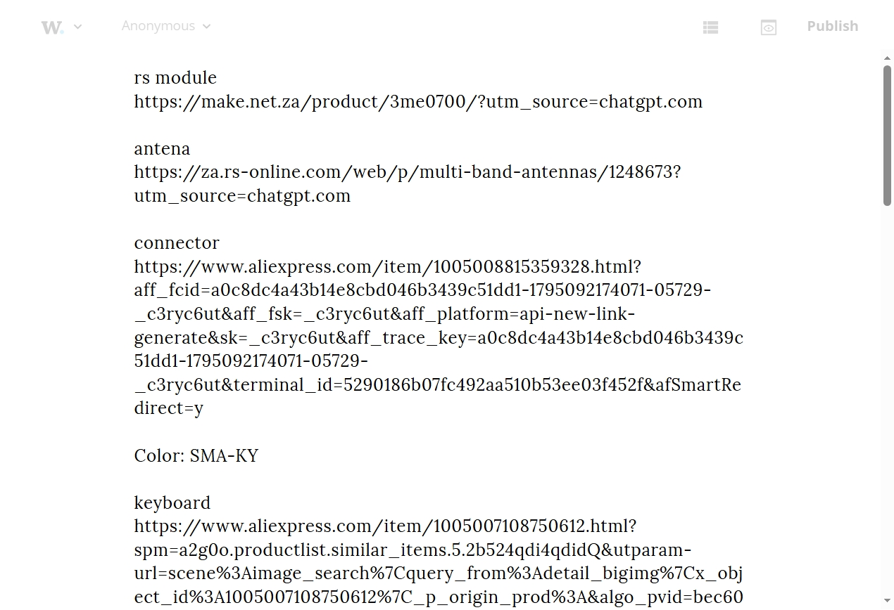

# Nov 20 2026

today i mainly did research on the different components id need for the project. The most hard part was finding a suitable radio
module andthe legal radio freaqrncies i can use.Along with that i found all the other components (List in components.md) and made
sure of their compatibility as well as writing this GitHub repository

### component research          [5 hours, 3pm-8pm]

---

# Nove 21 2026 - Nov 22 2026

I've been working on the PCB a lot. First, I lost my previous PCB design 😅 My PC's power cable came out, and I didn't think to save my progress. But it turned out OK because it turned out that the PCB had a lot of flaws. It was my first PCB design after all. I kept on using different layers to prevent my traces from touching but I didn't know that I was supposed to use only the top and bottom layers and connect them with something called a via to prevent them from touching. Armed with this new knowledge and experience, I created a new pc that was more precise and configured correctly in less time 🥳

### old pcb nov 21 + new pcb nov 22 [3 hour + 3 hours = 6 hours]

Along with that, I had to do a lot more research simultaneously about the different components I'm using and checking what pins go where to the esp. things like the rf module I switched to the surface mounted version so I can use jlcpcb's sme service rather than buying and soldering it with headers myself

