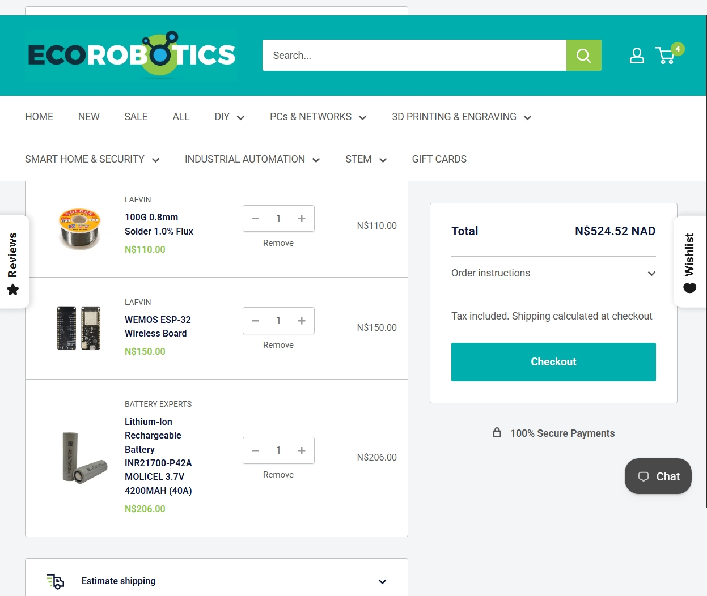

# Nov 19 2026

today i mainly did research on the different components id need for the project. The most hard part was finding a suitable radio
module andthe legal radio freaqrncies i can use.Along with that i found all the other components (List in components.md) and made
sure of their compatibility as well as writing this GitHub repository

### component research          [5 hours, 3pm-8pm]

