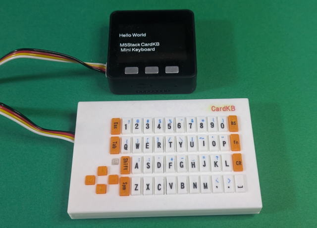

# Text-Talky

This is a handheld mini texting device that communicates using radio, three of them to be exact. This allows them to be used offline without an internet connection though it does mean that they have a limited range of about a few kilometers.

Instead of connecting everything with messy juper wire ill desihn a pcb that connect all the necesary components to the esp this way the project is neater and more compact.

I chose to design it kind of like a Nintendo ds where they can fold in when not in use, but for the input I chose a qwerty pcb keyboard instead of a touchscreen display the display like everything else will be connected to an esp the main processor for the project. Here is more information about the different components of the Text Talky.

---

## ~DISPLAY

the display is a 2.4 Inch TFT LCD Display Module. I chose this display module specifically because it had only a few pins. This is important because the Esp 32 doesn't have too many digital io pins meaning as I design, I have to actively rashin the available pins.

besides having few pins, the display also has full RGB is compatible with the Esp 32 support and is relatively the size I want the whole project to be. The TFT display will be mounted on the top half of the 3d printed case and connected to the lower half where the Esp is with perfectly aligned jumper cables.

---

## ~input

for the input I chose to use the M5Stack CardKB2 keyboard. It only uses three pins is just the right size for the project. it stand just above the pcb with the Esp on it and will be connected with a cable that comes in the package

but instead of having the keyboard pcb be exposed as the final design I found this design for a 3d printed enclosure for the M5Stack CardKB2 keyboard. This will make the project's design look better and prevent having to press the tedious small buttons 

---

## ~Radio communication

The Text Tallky uses a LoRa (Long Range) radio communication to send messages directly between two devices without needing Wi-Fi, mobile data, SIM cards or internet access. Each device uses an ESP32 microcontroller connected to an SX1262 LoRa radio module, which converts digital messages into radio signals and transmits them through an antenna. The receiving device picks up these signals and converts them back into readable text, which is displayed on its screen. Both devices can send and receive messages, allowing two-way communication over long distances. The achievable range depends on factors such as terrain, obstacles, antenna placement and radio settings.

## ~power supply

---

I'm not trying to make the most complicated power supply in the world and Im in luck as the Esp I chose alredy has an integraded battery chrger meanig all i essentially need is a simple lithium-ion battery

---

